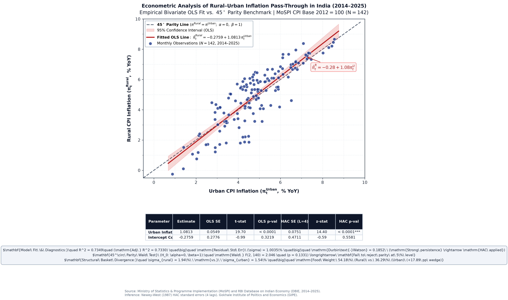

# Econometric analysis of rural-urban inflation pass-through in India (2014-2025)

[](https://www.python.org/downloads/)
[](https://en.wikipedia.org/wiki/Econometrics)
[](https://www.statsmodels.org/)
[](https://opensource.org/licenses/MIT)
[](https://gipe.ac.in/)

An empirical project on spatial price transmission, parity testing, and consumption basket differences between rural and urban retail markets in India under flexible inflation targeting.

---

## Overview

This project estimates spatial retail inflation pass-through between rural and urban India using monthly Consumer Price Index data (Base 2012 = 100) published by the Ministry of Statistics and Programme Implementation (MoSPI). The sample covers 142 synchronized months from January 2014 to December 2025.

The baseline model is:
$$\pi_t^{Rural} = \alpha + \beta \pi_t^{Urban} + \varepsilon_t$$

Because the regression residuals show strong persistence (Durbin-Watson = 0.1852), standard errors are calculated with the Newey-West (1987) HAC estimator using 4 lags.

The estimated slope is $\hat{\beta}_1 = 1.0813$ ($p < 0.0001, z = 14.40$). Urban inflation explains 73.5% of the variation in rural inflation ($R^2 = 0.7349$). A joint Wald test fails to reject the 45-degree parity null ($\alpha = 0, \beta = 1$) with $F(2, 140) = 2.046$ ($p = 0.1331$), indicating close long-run alignment.

The point estimate above 1 reflects rural inflation amplification during price run-ups. This behavior tracks the commodity weighting of each index: food and beverages accounts for 54.18% of the rural basket compared to 36.29% of the urban basket (a 17.89 percentage point gap). Because agricultural commodities experience weather and supply shocks, rural headline inflation exhibits higher volatility ($\sigma_{rural} = 1.94\%$ vs. $\sigma_{urban} = 1.54\%$).

---

## Research questions

1. **Pass-through elasticity:** Does urban retail inflation transmit one-for-one to rural markets, or is there an amplification or dampening effect?
2. **Parity testing:** Is the empirical relationship statistically distinguishable from frictionless long-run parity ($\alpha = 0, \beta = 1$)?
3. **Weight divergence:** How does the 17.89 percentage point food weight wedge between rural and urban baskets shape headline volatility and monetary policy transmission?

---

## Scatter plot

The scatter plot below compares monthly observations against the fitted OLS line, 95% confidence interval, and the 45-degree parity reference line.



*Figure 1: Bivariate OLS fit vs. 45-degree parity benchmark. Data source: MoSPI CPI Base 2012=100 and RBI DBIE (2014-2025, N = 142).*

---

## Econometric estimates

### 1. Bivariate OLS and Newey-West HAC
$$\pi_t^{Rural} = \alpha + \beta \pi_t^{Urban} + \varepsilon_t$$

| Regressor / Parameter | Coefficient ($\hat{\theta}$) | OLS SE | $t$-statistic | $p$-value | Newey-West HAC SE ($L=4$) | $z$-statistic | HAC $p$-value |
| :--- | :---: | :---: | :---: | :---: | :---: | :---: | :---: |
| **Urban Inflation ($\beta_1$)** | **1.0813** | 0.0549 | 19.70 | $< 0.0001$ | **0.0751** | **14.40** | **$< 0.0001$** |
| **Intercept ($\alpha$)** | -0.2759 | 0.2776 | -0.99 | 0.3219 | 0.4711 | -0.59 | 0.5581 |

*Note: N = 142 monthly observations from January 2014 to December 2025.*

#### Diagnostics
- $R^2$: 0.7349 (Adjusted $R^2$: 0.7330)
- Model $F$-statistic: $F(1, 140) = 388.1$ ($p < 0.0001$)
- Residual standard error: 1.0035%
- Durbin-Watson statistic: 0.1852 (positive serial correlation present; handled with Newey-West HAC standard errors)
- Residual Jarque-Bera: 6.132 ($p = 0.0466$)

---

### 2. 45-degree parity hypothesis test
The joint restriction tests whether prices move with one-for-one parity:
$$H_0: \begin{pmatrix} \alpha \\ \beta \end{pmatrix} = \begin{pmatrix} 0 \\ 1 \end{pmatrix} \quad \text{vs.} \quad H_1: \begin{pmatrix} \alpha \\ \beta \end{pmatrix} \neq \begin{pmatrix} 0 \\ 1 \end{pmatrix}$$

| Hypothesis test | Restriction | Test statistic | Degrees of freedom | $p$-value | Decision |
| :--- | :---: | :---: | :---: | :---: | :---: |
| **Joint 45° Parity** | $\alpha = 0, \; \beta = 1$ | **Wald $F = 2.0462$** | $df_1 = 2, \; df_2 = 140$ | **0.1331** | **Fail to reject $H_0$ at 5% level** |

With $p = 0.1331$, the data does not reject the joint parity condition at the 5% level. Rural and urban retail prices cointegrate over the full sample, while the point estimate $\hat{\beta} = 1.0813$ shows that rural inflation rises faster than urban inflation during upward price movements.

---

### 3. Summary statistics (2014-2025)

| Series | $N$ | Mean (%) | Std Dev (%) | Median (%) | Min (%) | Max (%) | Skewness | Excess Kurtosis |
| :--- | :---: | :---: | :---: | :---: | :---: | :---: | :---: | :---: |
| Rural Inflation ($\pi_t^{Rural}$) | 142 | 4.94% | 1.94% | 5.28% | -0.25% | 8.66% | -0.40 | -0.39 |
| Urban Inflation ($\pi_t^{Urban}$) | 142 | 4.82% | 1.54% | 4.72% | 0.88% | 8.56% | +0.12 | -0.03 |
| Wedge ($\pi_t^R - \pi_t^U$) | 142 | +0.12% | 1.01% | +0.22% | -2.65% | +1.75% | -0.60 | -0.07 |

---

## Basket weight comparison

The difference in inflation volatility between rural and urban series connects directly to expenditure weights in the MoSPI CPI basket (Base 2012 = 100):

| MoSPI CPI commodity group | Rural weight (%) | Urban weight (%) | Combined weight (%) | Rural-urban wedge (pp) |
| :--- | :---: | :---: | :---: | :---: |
| 1. Food and beverages | 54.18% | 36.29% | 45.86% | +17.89 pp |
| 2. Pan, tobacco and intoxicants | 3.26% | 1.36% | 2.38% | +1.90 pp |
| 3. Clothing and footwear | 7.36% | 5.57% | 6.53% | +1.79 pp |
| 4. Housing | 0.00% | 21.67% | 10.07% | -21.67 pp |
| 5. Fuel and light | 7.94% | 5.58% | 6.84% | +2.36 pp |
| 6. Miscellaneous services | 27.26% | 29.53% | 28.32% | -2.27 pp |
| Total general index | 100.00% | 100.00% | 100.00% | 0.00 pp |

Three practical implications follow:
1. **The food wedge:** Rural households allocate 54.18% of their consumption basket to food and beverages, compared to 36.29% in urban areas.
2. **Exposure to crop shocks:** Agricultural products are vulnerable to monsoon variability and transport snags. The higher rural weight translates perishable food price spikes directly into higher headline volatility.
3. **Housing weight:** Urban CPI allocates 21.67% to housing rents, which adjust slowly. MoSPI excludes rural housing from the index due to rural homeownership patterns.

---

## Policy context

1. **Monetary policy limits on food prices:** The RBI repo rate influences aggregate demand through urban credit markets. It does not resolve localized harvest losses or seasonal supply shortages.
2. **Purchasing power impact:** Because rural households spend a higher fraction of income on food, prolonged food inflation reduces rural real wages faster than urban wages.
3. **Supply-side complements:** Maintaining rural price stability requires monetary policy to operate alongside food buffer stock releases, cold-chain transport, and targeted grain distribution.

---

## CV bullet points

- **Econometric modeling of spatial inflation pass-through:** Analyzed 12 years of monthly MoSPI CPI data ($N = 142$, 2014-2025); estimated bivariate OLS with Newey-West (1987) HAC standard errors ($\hat{\beta}_1 = 1.0813, z = 14.40, p < 0.0001; R^2 = 0.735$), showing urban prices account for 73.5% of rural inflation variance.
- **Hypothesis testing and basket analysis:** Applied joint Wald testing to evaluate 45-degree long-run parity [$F(2, 140) = 2.046, p = 0.133$], confirming spatial co-movement; linked rural amplification ($\beta > 1$) and volatility ($\sigma_{rural} = 1.94\%$ vs. $\sigma_{urban} = 1.54\%$) to the 17.89 percentage point food weight gap between baskets.
- **Reproducible pipeline:** Built Python scripts and executed Jupyter notebooks generating 300 DPI figures, diagnostic tables, and a single-page summary document.

---

## Summary takeaway

1. Bivariate OLS estimates on Indian CPI data (2014-2025, $N = 142$) show an urban pass-through coefficient of $\hat{\beta}_1 = 1.0813$ ($p < 0.0001$; Newey-West HAC SE = 0.0751, $z = 14.40$), with urban price changes accounting for 73.5% of rural inflation variance.
2. A joint Wald test fails to reject 45-degree parity [$F(2, 140) = 2.046, p = 0.1331$], supporting long-run co-movement between regions while capturing higher rural sensitivity ($\beta > 1$) during price increases.
3. This pattern stems from consumption basket composition: food comprises 54.18% of rural CPI versus 36.29% of urban CPI (+17.89 pp), exposing rural households to higher price volatility ($\sigma_{rural} = 1.94\%$ vs. $\sigma_{urban} = 1.54\%$).

---

## Repository structure

```
rural_urban_inflation_passthrough/
├── README.md                                    # Documentation and empirical results
├── requirements.txt                             # Dependencies
├── .gitignore                                   # Version control exclusions
├── run_analysis.py                              # End-to-end analysis script
├── data/
│   ├── raw/
│   │   ├── cpi_inflation_cleaned.csv            # Monthly MoSPI CPI records (2014-2025)
│   │   └── India_Inflation_Master_Dataset...xlsx# Source workbook
│   └── processed/
│       └── rural_urban_inflation_monthly.csv    # Cleaned monthly rural, urban, and wedge series
├── docs/
│   ├── rural_urban_inflation_brief_1page.pdf    # One-page PDF brief
│   ├── rural_urban_inflation_brief_1page.html   # One-page HTML document
│   └── rural_urban_inflation_brief_1page.docx   # Word document version
├── src/
│   ├── __init__.py
│   ├── econometric_model.py                     # Estimation, HAC errors, and hypothesis testing
│   ├── generate_plot.py                         # Scatter plot generator
│   ├── generate_one_page_pdf.py                 # ReportLab PDF builder
│   ├── generate_one_page_html_docx.py           # HTML and Word builders
│   └── build_notebook.py                        # Notebook generation script
├── notebooks/
│   └── rural_urban_inflation_passthrough.ipynb  # Executed notebook
└── figures/
    └── rural_urban_ols_parity_scatter.png       # 300 DPI scatter plot
```

---

## Setup and replication

### 1. Clone the repository
```bash
git clone https://github.com/your-username/rural_urban_inflation_passthrough.git
cd rural_urban_inflation_passthrough
```

### 2. Set up virtual environment
```bash
python3 -m venv .venv
source .venv/bin/activate
pip install -r requirements.txt
```

### 3. Run the analysis
```bash
python run_analysis.py
```

### 4. Open the notebook
```bash
jupyter lab notebooks/rural_urban_inflation_passthrough.ipynb
```

---

## Data sources and references

1. Ministry of Statistics and Programme Implementation (MoSPI): All-India Consumer Price Index (Rural, Urban, Combined; Base Year 2012 = 100), Monthly Releases 2014-2025.
2. Reserve Bank of India: Database on Indian Economy (DBIE).
3. Newey, W. K., & West, K. D. (1987). A Simple, Positive Semi-Definite, Heteroskedasticity and Autocorrelation Consistent Covariance Matrix. *Econometrica*, 55(3), 703-708.
4. Patel, U. R., et al. (2014). Report of the Expert Committee to Revise and Strengthen the Monetary Policy Framework. Reserve Bank of India.
5. Engel, E. (1857). Die Productions- und Consumtionsverhältnisse des Königreichs Sachsen. *Zeitschrift des statistischen Büreaus des Königlich Sächsischen Ministeriums des Inneren*.

---

## Author and affiliation

- Economics student / researcher, Gokhale Institute of Politics and Economics (GIPE), Pune, India.
